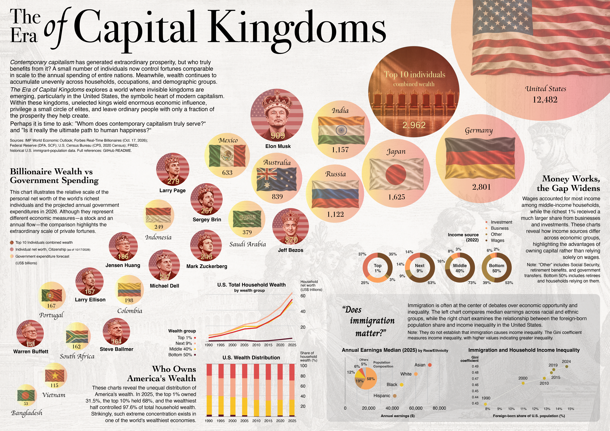

# The Era of Capital Kingdoms

**Static data visualization project** · CAPP 30239 Data Visualization · University of Chicago  
**Author:** Seiya Matsumoto · **November 2026**

[**View the full-resolution poster (PDF)**](static-viz/final.pdf)

## About the project

*The Era of Capital Kingdoms* examines how wealth and income are distributed in contemporary capitalism, with a focus on the United States. It compares the fortunes of the world's wealthiest individuals with national government expenditure, traces U.S. household wealth concentration, examines income sources across income groups, and explores differences in earnings and the relationship between immigration and income inequality.

The poster asks who benefits from economic prosperity and uses multiple datasets to make large differences in economic resources easier to see.

## Visualizations

| Poster section | Visualization | Exported chart |
| --- | --- | --- |
| **Billionaire Wealth vs. Government Spending** | Bubble chart comparing the top ten individuals' wealth with projected 2026 government expenditure in selected countries | `img/01.png` |
| **Who Owns America's Wealth?** | Line chart of household net worth by wealth group, 1990–2025 | `img/02a.png` |
| **Who Owns America's Wealth?** | Stacked bars showing each group's share of household wealth | `img/02b.png` |
| **Money Works, the Gap Widens** | Four donut charts showing income sources by income percentile group (2022) | `img/03.png` |
| **Does Immigration Matter?** | Survey-weighted median annual earnings by race/ethnicity (2025) | `img/04a.png` |
| **Does Immigration Matter?** | U.S. population composition by race/ethnicity (2020) | `img/04b.png` |
| **Does Immigration Matter?** | Scatter/connected-dot chart of foreign-born population share and the household-income Gini coefficient | `img/04c.png` |

The charts were produced with Python and Altair. The final poster was composed and refined in Adobe Illustrator, including visual styling, annotations, illustrations, and adjustments to exported charts. The final poster layout is therefore not generated automatically by the notebook. The editable Illustrator source file (`static.ai`) is kept locally because it exceeds GitHub's file size limit.

## Data sources

| Dataset | Source | Local file |
| --- | --- | --- |
| 2026 GDP and general-government expenditure projections | [International Monetary Fund — World Economic Outlook database](https://www.imf.org/en/Publications/WEO/weo-database) | `data/dataset_2026-10-17IMF.csv` |
| Top ten billionaire net-worth estimates, snapshot dated October 17, 2026 | [Forbes — Real-Time Billionaires](https://www.forbes.com/real-time-billionaires/) | `data/billionaires.csv` |
| U.S. household net worth by wealth group | [Federal Reserve — Distributional Financial Accounts](https://www.federalreserve.gov/releases/z1/dataviz/dfa/) | `data/dfa-networth-levels.csv`, `data/dfa-networth-shares.csv` |
| Family income and income components (2022) | [Federal Reserve — Survey of Consumer Finances](https://www.federalreserve.gov/econres/scfindex.htm) | `data/SCFP2022.csv` |
| Annual earnings by race/ethnicity (2025) | [U.S. Census Bureau — Current Population Survey, 2026 ASEC](https://www.census.gov/programs-surveys/cps/data/datasets.html) | `data/pppub26.csv` |
| Population by race/ethnicity (2020) | [U.S. Census Bureau — 2020 Census](https://www.census.gov/programs-surveys/decennial-census/decade/2020.html) | Values recorded directly in the notebook |
| Foreign-born share of the U.S. population | Historical immigrant-population series in the project data | `data/immigrants_2024.csv` |
| Household-income Gini coefficient | [Federal Reserve Bank of St. Louis (FRED) — GINIALLRH](https://fred.stlouisfed.org/series/GINIALLRH) | `data/GINIALLRH.csv` |

### Data availability

The 2026 CPS ASEC person-level dataset (`data/pppub26.csv`, approximately 248 MB) is excluded from this repository because it exceeds GitHub's 100 MB file limit.

The dataset is publicly available from the [U.S. Census Bureau's CPS data downloads](https://www.census.gov/programs-surveys/cps/data/datasets.html). To reproduce the CPS-based visualizations, download the 2026 ASEC person-level CSV and save it as `data/pppub26.csv`.

All generated charts are included in the `img/` directory.

## Reproducing the charts

The Jupyter notebook is in `src/`. It reads the input CSV files from `../data/` and exports the charts to `../img/`, so **run it with `src/` as the working directory**.

1. Install Python with `pandas`, `numpy`, `altair`, `jupyter`, and `vl-convert-python` (for PNG/SVG exports).
2. Keep the CSV files in `data/` and create an `img/` folder if one does not already exist.
3. Open the notebook in `src/` and run its cells from top to bottom.
4. The resulting numbered PNG and SVG files are saved in `img/`. The final Illustrator-designed poster is provided separately as `poster.pdf` in `static-viz/`.

## Notes on interpretation

- **Net worth is a stock; government expenditure is an annual flow.** The bubble comparison illustrates scale, not directly comparable annual purchasing power.
- **Income groups and wealth groups are different classifications.** The SCF income-source analysis uses survey-weighted family-income percentiles and the survey's five implicates; the wealth charts use Federal Reserve wealth groups.
- The donut charts combine interest/dividends and capital gains into **Investment**; **Other** is the residual share of income, including income sources not individually displayed.
- Earnings comparisons describe observed differences; they do not establish the causes of those differences.
- The immigration/Gini chart shows selected years and **does not establish a causal relationship** between immigration and inequality.

## Tools and process

Data preparation and chart generation: **Python, pandas, NumPy, Altair, Jupyter Notebook**.  
Final poster design: **Adobe Illustrator**.  
Generative AI was used for brainstorming, assistance with data exploration and code debugging, creating visual elements, and editing text. The final visual choices and poster composition were made by the author.

