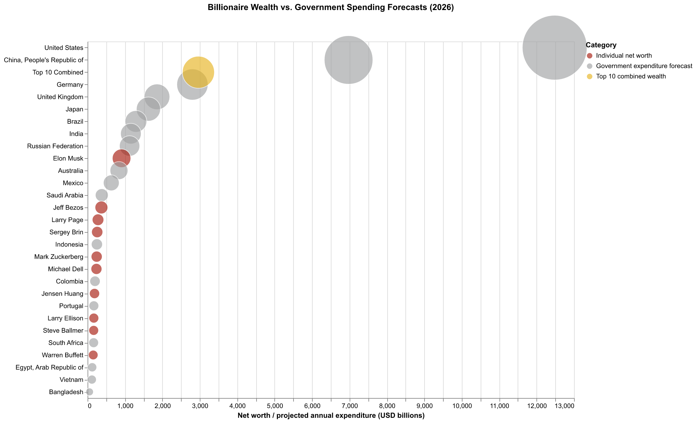
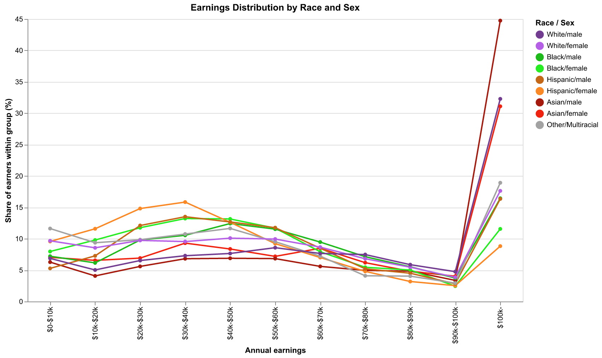
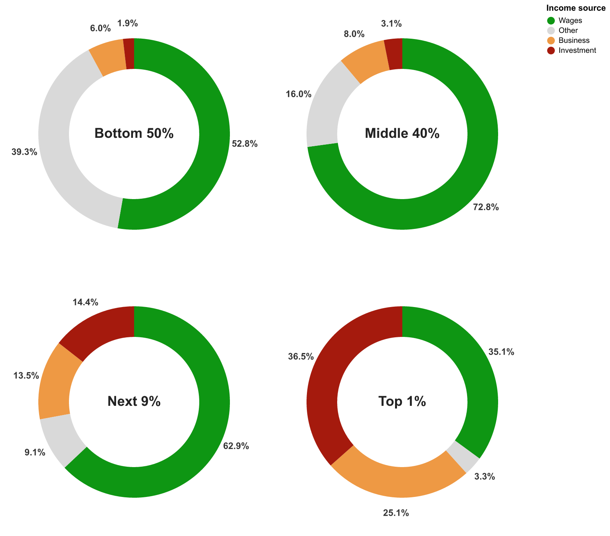
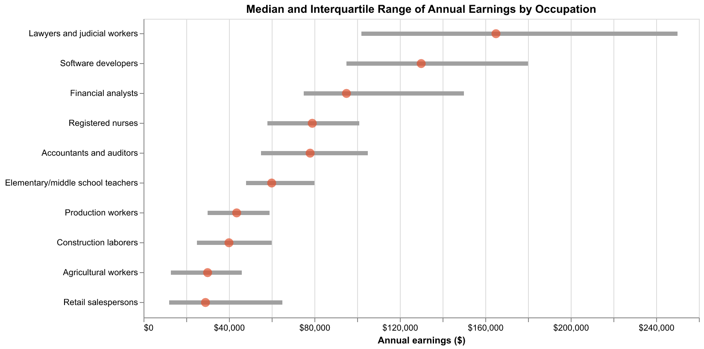
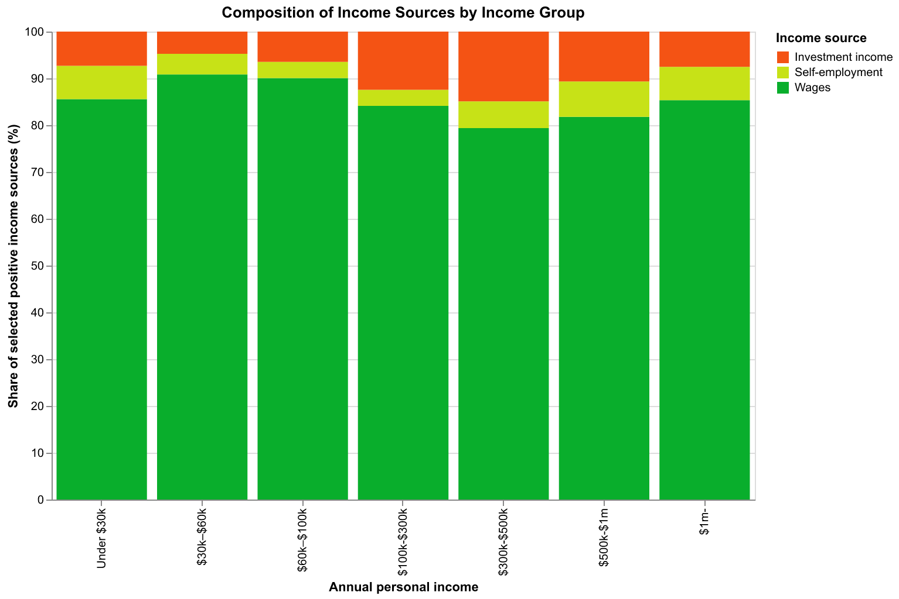
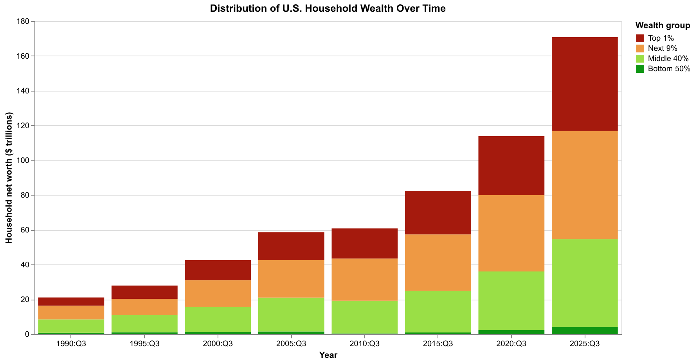
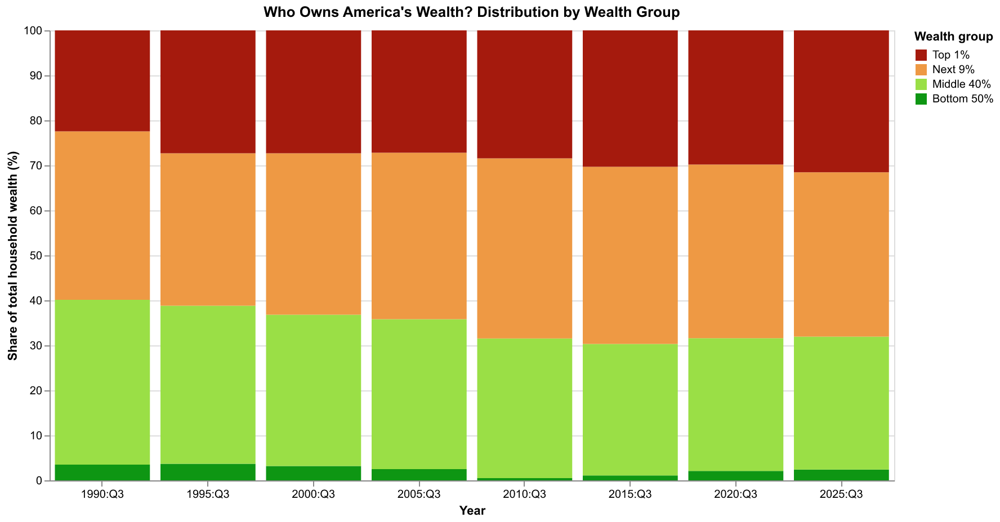
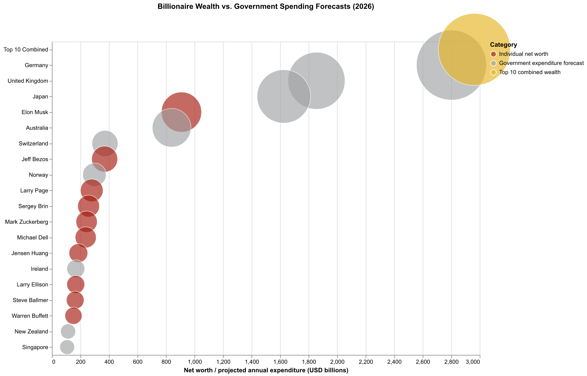
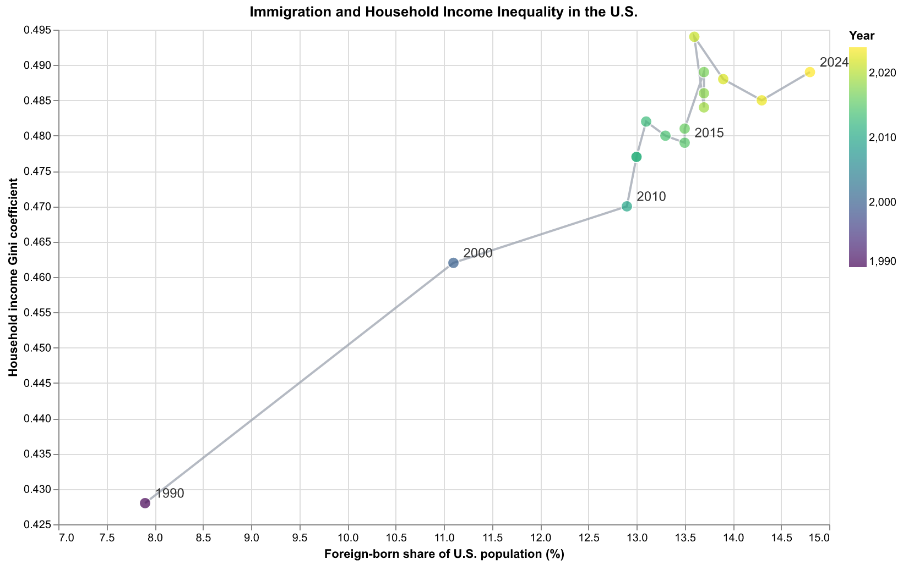

# Benefits from Contemporary Capitalism

Seiya Matsumoto

## What is your current goal? Has it changed since the proposal?

My goal is to explore the less visible sides of contemporary capitalism and visualize how economic prosperity is distributed across society. I want to create accessible, thought-provoking visualizations that encourage audiences to question how income and wealth differ among individuals, demographic groups, and nations, and what economic and social trade-offs may accompany prosperity.

My focus has expanded from individual income inequality to broader questions about wealth concentration and the relationship between private wealth and national economies.

## Are there data challenges you are facing? Are you currently depending on mock data?

Finding appropriate and comparable datasets has been challenging, especially when combining information from different sources and time periods. However, I have found useful real-world datasets from the U.S. Census Bureau, the Federal Reserve, the IMF, and other sources.

I am not using mock data. My next challenge is to refine the visualizations to present the findings accurate, accessible, and meaningful to a broad audience.

## Describe each of the provided images with 2–3 sentences to give the context and how it relates to your goal.

### 1. Distribution of Annual Earnings

This chart shows the distribution of annual earnings across income brackets in the United States. It introduces the broader question of economic inequality.

### 2. Earnings Distribution by Race and Gender

This chart compares earnings distributions across racial and gender groups. It highlights differences in economic outcomes.

### 3. Median Earnings by Race and Gender

This chart compares median earnings and earnings ranges across demographic groups. It shows differences in both typical earnings and their spread.

### 4. Earnings Differences Across Occupations

This chart compares median earnings and earnings ranges across ten occupations. It explores how earnings vary by profession.

### 5. Sources of Personal Income

This chart compares income sources across income brackets. It examines differences in reliance on wages, self-employment, and investment income.

### 6. Household Wealth Over Time and Shares of Household Wealth

This chart shows how household net worth has grown across wealth groups from 1990 to 2025. It highlights the concentration of wealth.

This chart compares the shares of total household wealth held by different groups. It reveals changes in wealth distribution over time.

### 7. Billionaire Wealth and Government Expenditure

This chart compares billionaire net worth with projected annual government expenditure in selected countries. It illustrates the scale of private wealth while contrasting two different economic measures.

### 8. Immigration and Income Inequality

This chart explores the historical association between the foreign-born population share and household income inequality in the United States. It does not establish a causal relationship.

## What form do you envision your final narrative taking? (e.g. An article incorporating the images? A poster? An infographic?)

I currently envision an interactive infographic or visual storytelling webpage that guides audiences through different dimensions of economic inequality.

For the final version, I may select three or four key visualizations to develop a clearer narrative and encourage deeper exploration.

## Data availability

The CPS ASEC 2026 dataset (`data/pppub26.csv`) is not included in this repository because its file size (approximately 248 MB) exceeds GitHub's 100 MB file limit.

The dataset is publicly available from the U.S. Census Bureau's Current Population Survey (CPS) ASEC public-use microdata. Download the 2026 person-level CSV and save it as `data/pppub26.csv` to reproduce the CPS-based visualizations.

All generated charts are included in the `img/` directory.
